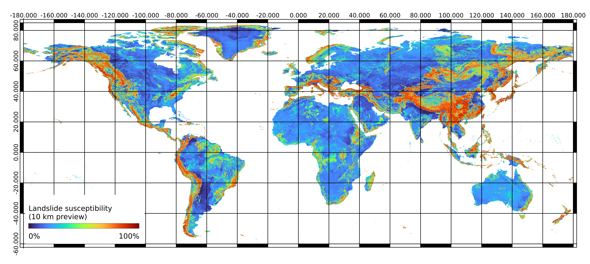

# GLaSs - Ensemble machine-learning global landslide susceptibility (GLS)




Code accompanying:

> Mancino, S., Colacicco, R., Lovergine, F. P., Sethi, T., Lindorfer, R., Wagner, W., Capolongo, D., and Amatulli, G.: Ensemble Machine Learning-Based Global Landslide Susceptibility From A Unified Global Inventory, Earth Syst. Sci. Data, [DOI].

The pipeline builds two Random Forest classifiers from the Unified Global Landslide Catalogue (UGLC) and 52 geo-environmental predictors on a 90 m grid, using two pseudo-absence schemes (Unconstrained and Slope Constrained), and merges them into an ensemble global susceptibility map (0–100).

Archived release: [Zenodo DOI]. 
Susceptibility maps: [data DOI].

## Repository layout

```
config/
  config.sh          paths, software environment and all model parameters
  predictors.tsv     the 52 predictors (name, raster) in model column order
  tiles.txt          20° x 20° processing tiles (created by 00_make_tile_list.sh)
scripts/
  00-20_*            pipeline steps (below)
  common.sh          shared bash helpers
  gls_common.py      shared Python helpers (thinning, spatial blocks, RF settings)
  predict_tile.py    tile prediction with pyjeo (called by 15_predict_map.sh)
  plotting/          figure scripts
slurm/
  python_job.sh      runs a Python step with the configuration loaded
```

## Pipeline

| Step | Script | Paper | Output (under `$WORK_DIR`) |
|---|---|---|---|
| 00 | `00_make_tile_list.sh` | – | `config/tiles.txt` |
| 01 | `01_uglc_points.py` | 3 | presence points from the UGLC point layer |
| 02 | `02_uglc_polygons.py` | 4.3, 6.4 | validation polygons, with type and factor codes |
| 03 | `03_inner_radius.sh` | 4.3 | inner ring radius (P99 of polygon equivalent radius) |
| 04 | `04_variogram_sampling.sh` | 4.3 | anchor–offset sample for the semivariograms |
| 05 | `05_variogram_fit.py` | 4.3 | practical ranges; outer ring radius |
| 06 | `06_absence_mask.sh` | 4.2 | per-tile eligibility mask for pseudo-absences |
| 07 | `07_absence_sampling.sh` | 4.2 | per-tile pseudo-absences |
| 08 | `08_absence_merge.sh` | 4.2 | `<model>/absence_points.txt` |
| 09 | `09_feature_extraction.sh` | 4.1, 4.4 | `<model>/training_table.txt` |
| 10 | `10_feature_correlation.py` | 6.3 | Spearman correlation matrix |
| 11 | `11_block_size_selection.py` | 4.5 | cross-boundary proximity by block size |
| 12 | `12_train_cv.py` | 4.4, 4.5 | spatial block CV, final model, permutation importance |
| 13 | `13_ensemble.py` | 4.6, 5.3 | pooled 1000-tree model; block-wise evaluation |
| 14 | `14_shap.py` | 6.3 | SHAP values of the ensemble model |
| 15 | `15_predict_map.sh` | 5.4 | susceptibility map tiles (0–100, Byte) |
| 16 | `16_map_statistics.sh` | 5.4 | map histogram and statistics |
| 17 | `17_jenks_breaks.py` | 5.5 | Fisher-Jenks natural breaks |
| 18 | `18_classify_map.sh` | 5.5 | five-class map |
| 19 | `19_polygon_zonal.sh` | 6.4 | map values over UGLC polygon pixels |
| 20 | `20_polygon_statistics.py` | 6.4 | statistics by type and factor; class distribution |

`<model>` is `slope_constrained` or `unconstrained`: steps 06–09 and 12 are run once
per parent model. Step 15 maps the ensemble model (and, optionally, each parent).

## Requirements

- GDAL ≥ 3.1 (command-line tools and `gdal_calc.py`), GRASS GIS, pktools
- Python 3.11 environment: `conda env create -f environment.yml`
- pyjeo for the map prediction (step 15); the interpreter is set by
  `gls_pyjeo_python` in `config/config.sh` (e.g. a container)
- An HPC scheduler is recommended (scripts carry SLURM headers; every step also runs
  with `bash`, tile-based steps taking the tile index as last argument).

## Input data

- UGLC point and polygon layers (CSV) as published with Mancino et al. (2026),
  https://doi.org/10.5194/essd-18-4697-2026; fields used: `ID`, `WKT_GEOM`,
  `RELIABILITY`, `TYPE`, `PHYSICAL FACTORS` (see `UGLC_*` in `config/config.sh`)
- The 52 predictors as global 90 m rasters (sources and native resolutions in Table A1
  of the paper), listed in `config/predictors.tsv`
- Permanent ice and permanent water masks at 90 m (1 = not ice / not water), derived
  from the ESA CCI Land Cover classes 220 (permanent snow and ice) and 210 (water
  bodies), permanent over 1992–2018

Set the paths in section 1 of `config/config.sh` (`DATA_DIR`, `WORK_DIR`,
`PREDICTOR_DIR`, …) and the raster paths in `config/predictors.tsv`, or put
site-specific paths and a `gls_setup_env` function (module loads) in
`config/config.local.sh`, which is read before `config.sh` and ignored by git.

## Running

Submit from the repository root (log files go to `logs/`):

```bash
mkdir logs
# UGLC inputs and ring-buffer radii
bash scripts/00_make_tile_list.sh
bash slurm/python_job.sh scripts/01_uglc_points.py
bash slurm/python_job.sh scripts/02_uglc_polygons.py
sbatch scripts/03_inner_radius.sh
sbatch scripts/04_variogram_sampling.sh
sbatch slurm/python_job.sh scripts/05_variogram_fit.py

# Training data of the two parent models
for m in slope_constrained unconstrained; do
  j6=$(sbatch --parsable scripts/06_absence_mask.sh $m)
  j7=$(sbatch --parsable --dependency=afterok:$j6 scripts/07_absence_sampling.sh $m)
  j8=$(sbatch --parsable --dependency=afterok:$j7 scripts/08_absence_merge.sh $m)
  sbatch --dependency=afterok:$j8 scripts/09_feature_extraction.sh $m
done

# Models
sbatch slurm/python_job.sh scripts/10_feature_correlation.py
sbatch slurm/python_job.sh scripts/11_block_size_selection.py
for m in slope_constrained unconstrained; do
  sbatch slurm/python_job.sh scripts/12_train_cv.py $m
done
sbatch slurm/python_job.sh scripts/13_ensemble.py
sbatch slurm/python_job.sh scripts/14_shap.py
bash slurm/python_job.sh scripts/plotting/plot_shap.py

# Map
sbatch scripts/15_predict_map.sh ensemble
bash scripts/15_predict_map.sh ensemble vrt          # once all tiles are done
sbatch scripts/16_map_statistics.sh ensemble
bash slurm/python_job.sh scripts/17_jenks_breaks.py
sbatch scripts/18_classify_map.sh
bash scripts/18_classify_map.sh ensemble vrt         # once all tiles are done

# Areal validation over UGLC polygons
j19=$(sbatch --parsable scripts/19_polygon_zonal.sh ensemble)
sbatch --dependency=afterok:$j19 slurm/python_job.sh scripts/20_polygon_statistics.py ensemble
```

Any other map in the same tile layout (e.g. NASA-GLS resampled to the 90 m tiles,
stored as `$MAP_DIR/nasa_gls/susceptibility_<TILE>.tif`) goes through steps 16, 19 and
20 in the same way; `--native` in step 20 uses its values directly as classes.

## Reproducibility

All random operations use `SEED` (default 42). Exact reproduction of the published
numbers also depends on the software versions listed in the paper and on the order of
records in the input tables.

## Licence

The code in this repository and the susceptibility map ([data DOI]) are released under the Creative Commons Attribution-NonCommercial 4.0 International License ([CC BY-NC 4.0](https://creativecommons.org/licenses/by-nc/4.0/); see `LICENSE`):
they may be shared and adapted with appropriate credit, for non-commercial purposes.
Commercial use requires the prior written permission of the copyright holders.
The paper is published under CC BY 4.0. Please cite the paper above when using this code or the map.

## Contact

Saverio Mancino (saveriomancino1@gmail.com | saverio.mancino@uniba.it), Giuseppe Amatulli (giuseppe.amatulli@yale.edu)


